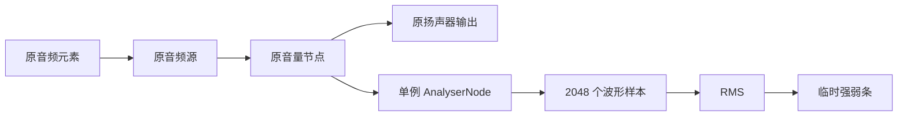

# 波形与 RMS 数据入口检查

网站左下角加入了“音频强度 · 临时检查”条。点击右上角声音按钮后，显示真实采样的 RMS；暂停后数值归零，强弱条平滑回落。入口只更新这个临时面板，场景参数和画布保持原样。

## 测量位置与复用

AudioContext、MediaElementAudioSourceNode 和 GainNode 沿用现有控制器。AnalyserNode 第一次播放时创建，连接到音量节点之后，分析节点的输出不另接扬声器。后续点击和失败重试复用该节点；波形 Float32Array 也只分配一次。

当前共三次核心连接：`source → gain`、`gain → destination`、`gain → analyser`。前两条原声音路由保留，第三条只测量。

## 数据计算与显示

- 使用 `getFloatTimeDomainData()` 读取 2048 个实际波形样本。
- 计算公式：`RMS = sqrt(sum(sample * sample) / sampleCount)`。
- 当前输出暂停、缓冲、失败或 AudioContext 停止运行时，有效 RMS 为 0，避免沿用旧波形窗口作为当前输出。
- 强弱条按 `min(1, RMS / 0.05)` 映射；数值表示采样信号幅度。
- 只对条的显示做平滑：上升响应 20、回落响应 6，按 deltaTime 更新，单帧上限 50 ms。原始 RMS 不做这种显示平滑。
- 数值与可访问性信息以最多 10 Hz 更新，采样跟随 RAF。暂停并回落到零后停止 RAF；下一次实际播放再唤醒。
- 不支持 Web Audio 的环境仍可使用原音频播放；检查条会明确显示分析入口不可用。

配置集中在 [audio-config.js](../../audio-config.js) 的 `meter` 字段，入口实现为 [audio-meter.js](../../audio-meter.js)。波形读取 API 参考 [MDN getFloatTimeDomainData 文档](https://developer.mozilla.org/en-US/docs/Web/API/AnalyserNode/getFloatTimeDomainData)。

## 验证结果

1. 连续采集约 1.2 秒的 60 个记录，播放时出现多组不同的非零 RMS，媒体时间持续前进。
2. 将实际复用的波形数组逐项平方、平均、开方，结果与入口保存的 `waveformRms` 完全一致，样本中同时出现正值与负值。
3. 播放保持进行时临时将 Gain 置零，RMS 归零；恢复 Gain 后数据重新变化，确认读到波形能量。测试结束时恢复原音量 0.18。
4. 暂停后有效 RMS 立即为零，条在后续采样中递减，最终为零；采样计数停止增长。
5. 4 个播放/暂停循环加 31 次快速连点，AudioContext、音频源、Gain、AnalyserNode 都各一个，连接不重复；波形数组分配次数为 1。
6. AudioContext 暂停后入口为零，恢复后使用原 Context 和原 AnalyserNode 继续获得波形；播放拒绝与重试也通过。
7. 签名、人物、背景星点三个画布的导出哈希在操作前后相同，章节参数相同。
8. 原声音控制的完整回归检查通过：6 次常规循环、61 次快速连点、加载失败、超时、取消加载、播放拒绝、连接恢复、实际播放结束及键盘操作。
9. 页面始终只有一个音频元素；浏览器脚本错误、意外资源失败均为 0，移动屏幕无横向溢出。

采样与检查数据：[verification.json](verification.json)。完整声音控制回归：[control-regression/verification.json](control-regression/verification.json)。

截图：[播放与暂停对照](rms-playing-vs-paused.png)、[播放](playing.png)、[暂停](paused.png)、[移动布局](mobile.png)。
