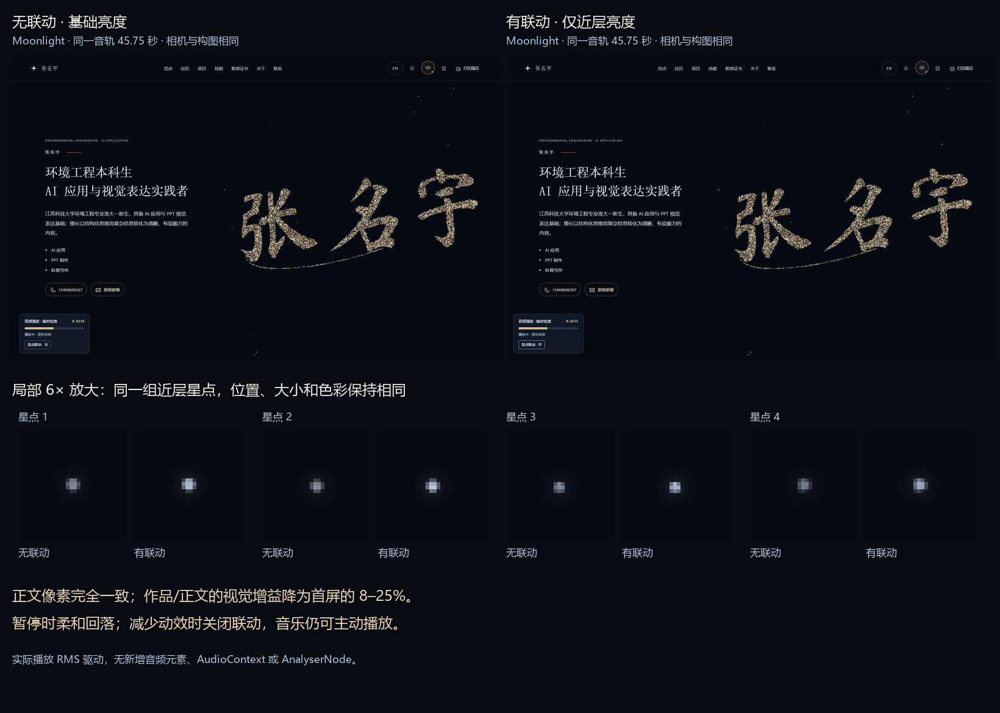

# 音乐与星点亮度对照

已在现有网站接入。只读取 `resumeAudioMeter.snapshot().rms`，不重新读取波形，也不增加音频元素或音频节点。默认开启联动；左下角临时检查面板的「星点联动」按钮可随时切换，音乐继续播放。

[打开对照页](http://127.0.0.1:8765/output/audio-stars-review/) · [返回网站](http://127.0.0.1:8765/#top)

## 修改及画面作用

| 修改 | 解决的问题 |
| --- | --- |
| 只联动 `near` 一组星点；另两层保持静态 | 让音乐有轻微反馈，避免整个背景跟着闪、抢走签名或人物的注意力 |
| 沿用原有星点坐标、大小、数量、色彩和软光晕范围 | 保持已经确认的空间构图与冷暖关系 |
| 缓存两张星点画布，只改变近层画布的合成透明度 | 音乐播放不会重新采样星点，也不会引入位置抖动或重绘全部背景 |
| 亮度限定在 0.85–1.45 倍，基础值为原亮度 1 倍 | 避免音乐峰值把少量亮星推得过亮 |
| 用帧间隔驱动指数平滑，单帧最多计算 50 ms | 消除短促音符造成的闪烁，切回标签页时不会突然跳变 |
| 暂停、缓冲或失败时，目标回到基础值并平滑回落 | 避免声音停止后亮星突然熄灭；回落结束后停止视觉更新循环 |
| 作品与正文段进一步降低响应，沿用原章节背景强度 | 保持项目详情、人物介绍与正文的阅读优先级 |
| 系统减少动效或网站暂停动效时，立即恢复静态亮度 | 关闭场景视觉联动，同时保留用户主动播放音乐的能力 |

## 集中参数

修改根目录 `audio-stars-config.js` 后刷新。亮度倍数作用于原有近层星点，不改变全页背景或主角。

| 参数 | 默认值 | 含义 |
| --- | --- | --- |
| `baseBrightness` | 1 | 静态基础亮度 |
| `gain` | 18 | 每单位实际 RMS 增加的亮度倍数 |
| `minimumBrightness` / `maximumBrightness` | 0.85 / 1.45 | 目标亮度上下限 |
| `smoothingSpeed` | 4 / 秒 | 播放中的响应速度 |
| `pauseSmoothingSpeed` | 3 / 秒 | 声音停止后的回落速度 |
| `maxDeltaTime` | 0.05 秒 | 单帧间隔上限 |
| `settleEpsilon` | 0.0005 | 回落到基础值时的收敛阈值 |
| `sectionGain` | 见下表 | 阅读时减弱响应 |

目标亮度为 `clamp(基础亮度 + RMS × gain × 章节系数, 下限, 上限)`。暂停时目标为基础亮度；平滑比例为 `1 - exp(-速度 × min(deltaTime, 0.05))`。

| 章节 | 视觉增益系数 |
| --- | --- |
| 首屏 | 1.00 |
| 亮点 | 0.18 |
| 作品 | 0.12 |
| 关于 | 0.25 |
| 经历 | 0.12 |
| 技能 / 教育 | 0.10 |
| 证书 | 0.08 |
| 联系 | 0.05 |

## 真实播放检查

测试使用本地 Scott Buckley《Moonlight》，音量仍为 0.14。同一音频元素、同一音频连接，分别重放 42 秒开始的片段；两次截图都在媒体时间 **45.750023 秒**记录，1600 × 1000，同一视角。为了定位相同音乐片段，测试浏览器为原 MP3 字节提供 HTTP Range 响应；网站的音乐源和音频控制代码均未改变。

- 无联动为 1.0000 倍；有联动记录为 1.4056 倍。实际播放片段的 RMS 在 0.00736–0.03519 间变化；亮度连续变化且始终在上下限内。
- 固定视口内为远层 108、中层 35、近层 10 个可见星点。音乐仅影响这 10 个近层星点；几何记录、所有缓存画布像素、签名与人物画布、章节构图参数均保持相同，没有新增采样或重绘。
- 全幅截图逐像素比较：差异只落在近层星点及临时音频检查面板；标题、简介、徽章与联系按钮区域的截图像素完全相同。
- 暂停后，亮度从 1.3383 倍柔和降至 1.2108 倍，最终回到 1 倍；视觉 RAF 随后停止。
- 逐章检查作品、关于、经历、技能、教育、证书、联系及向上返回首屏。相同 RMS 0.02 时，首屏目标为 1.36 倍，作品为 1.0432 倍，关于为 1.09 倍；音乐不中断。
- 项目按钮使用 Enter 选择、方向键连续切换两个真实项目、Esc 关闭，详情和焦点正常。联动按钮支持 Enter 开关，音乐时间连续前进。
- 动态开启系统减少动效：音乐继续播放，星点立即回到 1 倍，视觉循环停止。暂停后再次主动播放音乐正常。网站自己的暂停动效按钮同样保留音乐播放。
- 播放失败时回落至静态，重试成功。全过程只有 **1 个音频元素、1 个 AudioContext、1 个音频源、1 个 GainNode、1 个 AnalyserNode**，3 条原有连接；波形缓冲区只分配一次，所有对象继续复用。
- 30 / 60 / 120 FPS 模拟一秒后的亮度均约为 1.3926737444；5 秒长帧与 0.05 秒帧的更新结果相同。
- 390 × 844 移动端无横向溢出，联动按钮可用键盘操作。浏览器运行错误与资源加载失败均为 0。

完整数值与采样见 `verification.json`，检查脚本为 `verify-audio-stars.py`。局部动态对照来自真实播放截图，已放大；减少动效时对照页仅展示静态图片。

减少动效的读取方式遵循 [MDN 的 prefers-reduced-motion 文档](https://developer.mozilla.org/en-US/docs/Web/CSS/Reference/At-rules/@media/prefers-reduced-motion)。
